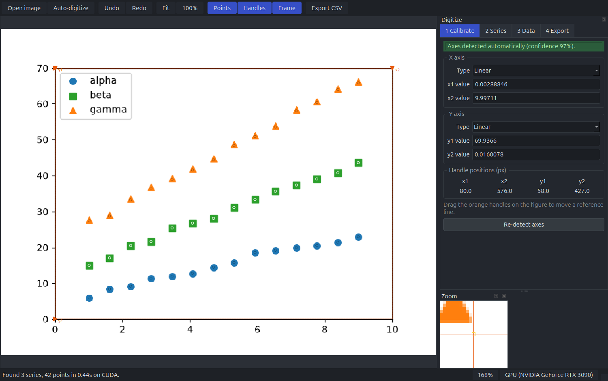

# Plot Digitizer

Published figures often show data that was never released as numbers. Getting it back
normally means loading the image into a digitizing tool and clicking: four times to
mark the axes, then once on every data point. A single figure can take several hundred
clicks, and the accuracy is limited by how steady your hand is.

This tool does that part for you. Open a figure and it works out, unaided:

- where the plot area is, even in styles that draw no axis lines at all
- what the tick labels say, including `10ⁿ` powers and `1e-3` multipliers
- whether each axis is linear, logarithmic, reciprocal or a date
- which curves are present — told apart by colour, and where colour does not help, by
  marker shape, line style and continuity — and where their points lie

You are left with the job you actually want: checking the result and correcting anything
it got wrong, then exporting a CSV.

## Where to go next

| | |
|---|---|
| [Getting started](getting-started.md) | Install it and digitize your first figure |
| [The interface](interface.md) | Every panel, tool, mouse action and shortcut |
| [Workflows](workflows.md) | Black-and-white figures, overlapping curves, batch runs |
| [Command line](cli.md) | Digitizing without opening a window |
| [FAQ](faq.md) | Limitations, troubleshooting, and how the accuracy was measured |

## What it is not

It reads 2D line and scatter plots. It does not read bar charts, pie charts, polar or
ternary plots, or three-dimensional figures. Curves drawn in one colour are told apart by
their style, but two drawn identically — the same marker, or the same line style lying
on top of each other — cannot be, and where curves genuinely overlap the information is
not in the image to recover. There are
[tools for sorting out what the automatic pass could not](workflows.md#black-and-white-figures).

The [FAQ](faq.md#limitations) sets out the limits in full. They are worth reading before
you trust a number.
